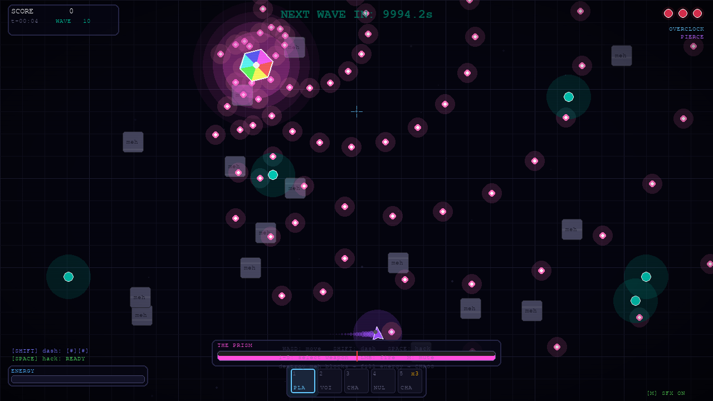

# ⚔️ The Blade's Playground

> *You are a shadow navigating a world of broken code, digital ghosts, and entropy.*
> *Hack the noise. Absorb the fragments. Survive long enough to go full chaos.*


A dark, glitchy top-down survival roguelike built in pure Python. No game engine, no external art or audio — movement, weapons, waves, music, particles, UI and a command console are all hand-coded and run locally.



*(The gameplay footage in [`docs/demo.gif`](docs/demo.gif) is the game being played by the balance-testing bot — see [Balance](#balance).)*

---

## Download

**[→ Releases page](https://github.com/flawnlawyer/blades-playground/releases/latest)** — Windows, macOS and Linux builds. No Python required: unzip and run.

> The builds are **unsigned**. Windows SmartScreen / macOS Gatekeeper will warn the first time (right-click → Open on macOS). Saves go to your per-user data folder, so they survive updates.

## Run from source

```bash
git clone https://github.com/flawnlawyer/blades-playground.git
cd blades-playground
pip install -r requirements.txt
python main.py
```
Python 3.10+. Windows, macOS, Linux.

---

## The loop

Hack corrupted blocks → collect code fragments → fill your energy → trigger **Chaos Mode** → tear everything apart. Clear waves, pick upgrades, beat the bosses, and bank **shards** for permanent progression between runs.

## Controls

| Action | Keyboard / mouse | Gamepad |
|---|---|---|
| Move | `WASD` / arrows | left stick |
| Aim | mouse | right stick |
| Fire | `LMB` (hold) | `RT` |
| Dash (2 charges, i-frames) | `SHIFT` | `A` |
| Hack (stun enemies, scrub bullets, break blocks) | `SPACE` | `X` |
| Switch weapon | `1`–`5` | `LB` / `RB` or D-pad ◀ ▶ |
| Mute | `M` | — |
| Pause | `ESC` | `START` |
| Console | `` ` `` or `F10` | — |
| Debug overlay / fullscreen | `F3` / `F11` | — |

Every keyboard action is **rebindable** (Settings → Controls). Menus work with the gamepad's D-pad + `A`/`B`. *(Gamepad support is implemented against SDL's standard controller layout and covered by tests using a simulated controller; it has not been verified on physical hardware yet.)*

## Weapons

| # | Weapon | Notes |
|---|---|---|
| 1 | **Plasma Bolt** | Fast, long range |
| 2 | **Void Spread** | 5-shot cone |
| 3 | **Chain Zap** | Auto-chains between nearby enemies |
| 4 | **Null Beam** | Hold to sustain; drains energy; aim precisely |
| 5 | **Chaos Bomb** | Lobbed, 1.4 s fuse, big blast (recharging charges) |

## Enemies

| Enemy | Behaviour |
|---|---|
| **Standard / Hunter / Swarm Node / Phantom** | The original four: wanderer, relentless chaser, fast pack, translucent 3-HP |
| **Berserker** | Slow tank; below 50% HP it enrages and sprints |
| **Teleporter** | Blinks around you; only vulnerable just after a blink — or while hack-stunned |
| **Shield Drone** | Orbits another enemy and makes it immune until the drone dies |
| **Splitter** | Bursts into two Swarm Nodes |
| **Sniper** | Keeps its distance, draws a laser line, then fires one fast bullet — dash through it or hack it |
| **The Architect** *(boss, waves 5, 15, 25…)* | Mirrors your movement, spawns minions |
| **The Prism** *(boss, waves 10, 20, 30…)* | Bullet-hell: telegraphed spiral, gapped ring, aimed fan, bloom |

Enemy bullets can be **dodged with dash i-frames**, **cleared with Hack**, and are erased on contact in **Chaos Mode**. New enemies spawn in with a short harmless grace period.

## Perks, evolutions & synergies

Clear every second wave (and every boss wave) and pick 1 of 3 upgrades.

* **Perks:** Overclock · Pierce · Arc Lattice · Phase Drive · Surge · Salvage · Volatile Core · Repair · Second Wind
* **Evolutions** (appear once you own the prerequisites): **Homing Bolts** · **Void Bloom** · **Tesla Coil** · **Null Lance** · **Cluster Bombs**
* **Synergies** (switch on automatically; the picker hints which card completes one): Detonating Trails · Slipstream · Overcharged Arc · Last Stand · Regen Matrix

## Progression

Finish a run (cheats off) and earn **shards**. Spend them in the **Armory** on permanent upgrades (Vitality, Quickstep, Reserves, Magnet, Arsenal), unlock starting weapons and starter perks, and chase 10 achievements. **Daily Runs ignore all upgrades** so the daily board stays level.

## Daily Run

Seeded by the UTC date — everyone gets the same arena, spawn positions and perk offers. Your best score per day is kept locally and the game-over screen prints a checksummed **share code** to send to friends (`C` copies). There is no server, so no global leaderboard, and the code is tamper-*evident*, not cheat-proof.

## Console & terminal control

Press `` ` `` in-game for a command console — or just type the same commands into the terminal you launched the game from. 44 commands: `god`, `perk all`, `spawn berserker 5`, `boss prism 2`, `wave 15`, `dmg 10`, `timescale 0.3`, `bloom 1.2`, `theme 3`, `about`… Full list: **[CONSOLE.md](CONSOLE.md)**.
**Any cheat flags the run: it is never saved to scores, the daily board or your progression.**

## Settings

Volume, music, screen shake, hit-stop, bloom level, vignette, fullscreen, gamepad on/off and deadzone, and full key rebinding — all saved instantly.

## Command-line options

| Flag | What it does |
|---|---|
| `--stress N` | Keep ~N enemies alive and make you unkillable (engine stress test; `F3` for stats) |
| `--gpu` | Experimental: SDL2 GPU scaling/presentation (falls back automatically) |
| `--terminal` / `--no-terminal` | Force / disable console commands from stdin |

---

## Under the hood

* **Rendering** — sprite caches instead of per-frame allocations, baked backgrounds and a multiply-blend vignette, a cheap bright-pass **bloom**, wave-band colour themes with cross-fades.
* **Engine** — a **spatial hash** for collisions, a **NumPy-vectorised dust field** (thousands of sparks for the cost of a few hundred objects), automatic level-of-detail for huge crowds. Details and the benchmarks that justified each choice are in [CHANGELOG.md](CHANGELOG.md).
* **Audio** — every sound and the **reactive layered music** are synthesised at startup with NumPy. Zero audio files.
* **Frame-rate independent** — movement scales with `dt`; hit-stop and slow-motion are real-time.

## Balance

Difficulty is tuned with data, not vibes. [`tools/balance_bot.py`](tools/balance_bot.py) is a heuristic bot that plays the real game headlessly; [`tools/balance_report.py`](tools/balance_report.py) summarises its runs. Findings and the experiments behind every number are in **[docs/BALANCE.md](docs/BALANCE.md)**.
The bot is a fixed, mediocre player: its results are only meaningful as *relative* comparisons, never as a prediction of how a human will do.

## Project structure

```
blades-playground/
├── main.py                     # entry point, CLI flags
├── game/
│   ├── game.py                 # core loop: entities, collisions, perks, bosses
│   ├── entities.py             # enemies, bosses, projectiles, bullets
│   ├── player.py  perks.py  tuning.py  wave_manager.py  console.py
│   ├── renderer.py  ui.py  particles.py  dust.py  music.py  audio.py  perk_icons.py
│   └── states/                 # menu, play, pause, perk, armory, settings, controls, game over …
├── utils/
│   ├── keybinds.py  gamepad.py  settings.py  meta.py  daily.py  spatial.py
│   ├── data_manager.py  paths.py  gpu.py  helpers.py
├── tools/                      # balance_bot, balance_report, stress_bench, gen_docs, package_release, make_icon
├── tests/                      # headless unittest suite
├── docs/                       # screenshots, BALANCE.md, balance data
└── .github/workflows/          # CI (tests) and tagged releases
```

## Development

```bash
python -m unittest discover -s tests          # headless; works on CI
python tools/gen_docs.py                      # regenerate CONSOLE.md (a test fails if it's stale)
python tools/stress_bench.py 100 500 1000     # engine benchmark
```

### Building a release

See **[RELEASE.md](RELEASE.md)**. Pushing a tag like `v3.0.0` runs the tests on three operating systems, builds binaries with PyInstaller and publishes a GitHub Release.

---

## Philosophy

Ship a working v1 fast, fix everything in v2 — then keep measuring. The code is modular not because modularity is virtuous in the abstract, but because it makes the next feature easier to wire without breaking the last one. No engine. No asset pipeline. No bloat. Just Python doing what Python does — fast enough to be fun, expressive enough to stay weird.

The fragment pool is the soul of this game. Every line in it is real.

## Author

**Ayush** (`@flawnlawyer`)
Open-Source Developer · AI Safety Researcher · BCSIT @ Pokhara University
→ [github.com/flawnlawyer](https://github.com/flawnlawyer)

## License

MIT. Fork it, break it, ship something weirder.
